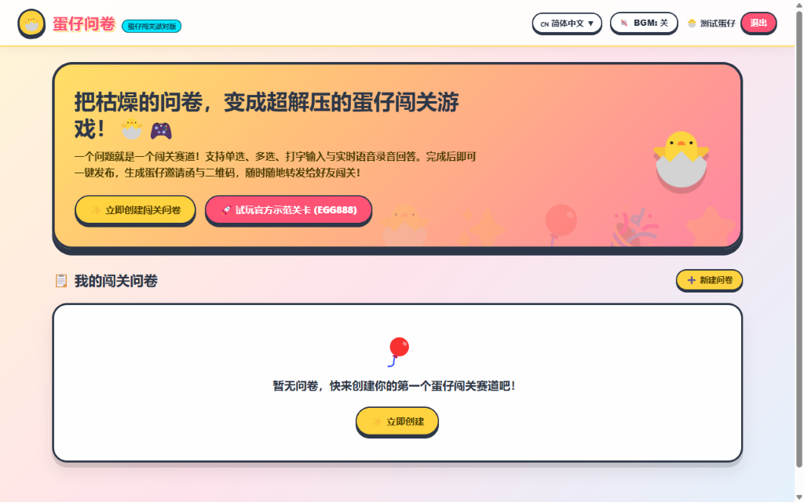

# 🥚 蛋仔问卷 (EggboySurvey)

> 把枯燥的问卷，变成超解压的蛋仔闯关游戏！

---
## 🌐 在线试用 DEMO

**试用网址：** https://eggboysurvey-production.up.railway.app/

> 说明：这是一个试用网址，部署在 Railway 试用环境上，仅供体验试用，数据可能随时重置，服务也可能随试用额度结束而下线。
---



## 📖 项目介绍

**蛋仔问卷**是一款结合了 **3D 跑酷游戏** 与 **问卷调查** 的创意 Web 应用。用户操控可爱的蛋仔角色在游戏关卡中奔跑，通过闯关完成问卷题目，让调查变得有趣、有参与感。

## ✨ 主要功能

- 🎮 **游戏化闯关** — 每道题对应一个关卡，跑过钻石自动收集，答完即通关
- 🌍 **四语言切换** — 支持简体中文、繁体中文、日语、英语
- 📋 **问卷管理** — 创建、编辑、发布问卷，查看统计结果
- 👤 **用户系统** — 注册登录，问卷与游戏进度绑定账号
- 🛡️ **管理员后台** — 管理所有用户和问卷数据
- 🔗 **访客浏览** — 未登录也可查看最近 10 份问卷

## 🎮 游戏玩法

```
登录 → 选择问卷 → 进入关卡 → 跑步收集钻石 → 到达终点回答题目 → 闯关！
```

| 按键 | 功能 |
|------|------|
| `↑` / `W` | 向前跑 |
| `←` / `A` | 向左转 |
| `→` / `D` | 向右转 |
| `Space` | 跳跃 |

## 🛠️ 技术栈

| 层级 | 技术 |
|------|------|
| 前端 | 原生 HTML5 / CSS3 / JavaScript |
| 3D 引擎 | Three.js |
| 后端 | Node.js + Express |
| 数据存储 | JSON 文件 |

## 🚀 本地运行

```bash
git clone https://github.com/liukaixy2010-cell/eggboySurvey.git
cd eggboySurvey
npm install
node server.js
```

## 📁 项目结构

```
eggboySurvey/
├── server.js          # 后端服务器
├── db.js              # 数据库模块
├── public/
│   ├── index.html     # 单页应用入口
│   ├── css/style.css  # 全局样式
│   └── js/
│       ├── app.js     # 主应用逻辑
│       ├── game3d.js  # 3D 游戏引擎
│       ├── i18n.js    # 多语言支持
│       └── ...
├── data/              # 数据文件
└── uploads/           # 上传文件
```

---

> 🥚 **蛋仔问卷** — 让每一次调查都变成一场冒险！
